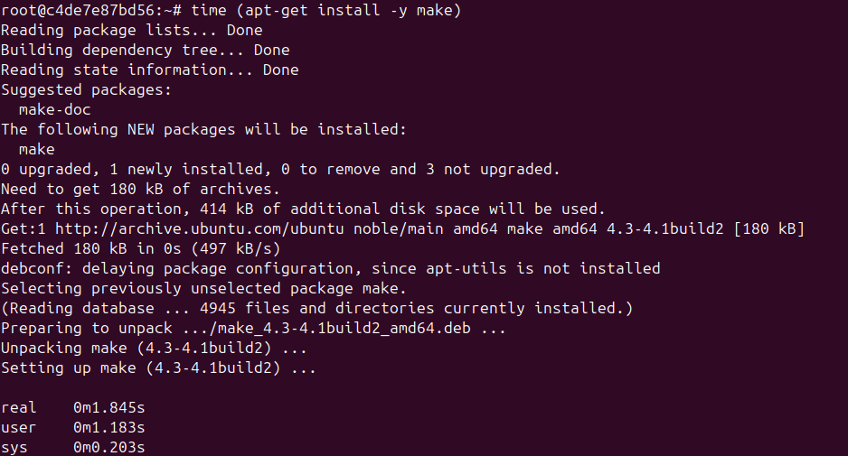
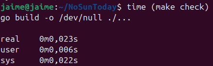
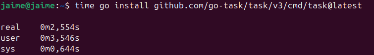
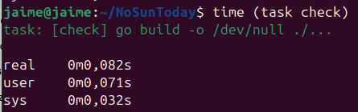
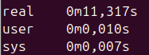
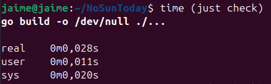

# Gestor de Dependencias

El gestor de dependencias es clave para poder gestionar las dependencias externas que se van a usar en el repositorio y que otros colaboradores deberán tener para poder trabajar correctamente con el código. Los criterios para decidir un buen gestor de dependencias son:

- Se sigue el estándar del lenguaje, en este caso Go.
- Se siguen las mejores prácticas.
- Tratar de evitar la deuda técnica en la medida de lo posible.
- La instalación del gestor sea lo más simple y rápida posible.
- El gestor funcione bien con las dependencias que se van a utilizar en el proyecto.

Teniendo en cuenta estos aspectos, en primer lugar se ha decidido buscar el estándar de Go para gestionar las dependencias. Indagando en la documentación oficial de Go, el estándar utilizado para gestionar las dependencias es Go Modules, que viene integrado junto a la instalación de Go (https://go.dev/doc/modules/managing-dependencies). Es por tanto, la mejor práctica para la gestión de las dependencias, pues el gestor oficial que Go insta a utilizar en su página de documentación. Utilizar el gestor integrado y totalmente estable permite reducir la deuda técnica ostensiblemente, pues utilizar un gestor de dependencias obsoleto implica tener que cambiarlo con posterioridad. La instalación del lenguaje Go instala a su vez el gestor de dependencias Go Modules, por lo que la instalación es tan simple como instalar el propio lenguaje. Aún no se saben con exactitud las dependencias que se van a usar en el proyecto (relacionadas con OSM), pero Go Modules es un gestor que funciona de forma fluida e integrada con Go.

Se ha buscado a su vez información sobre otros gestores de dependencias que no sean el estándar, sin embargo todos están obsoletos y recomiendan utilizar Go Modules. Teniendo en cuenta esto, se ha tomado la decisión de utilizar el gestor de dependencias integrado para que todo fluya de la mejor manera.

# Gestor de Tareas

Al igual que debemos tener una manera de gestionar las dependencias, es necesaria una forma de gestionar las tareas y automatizar una serie de comandos usados para completar una función. Mientras que Go tiene un gestor de dependencias integrado y mantenido, carece de un gestor de tareas estándar y lo único que tiene es un conjunto de comandos que tratan de cubrir lo que otros lenguajes resuelven con un gestor de tareas propio. Sin embargo, no hay una manera de aunar estas tareas para automatizar acciones como, por ejemplo, ejecutar tests concretos o comprobar la sintaxis de las entidades. Por tanto, se ha buscado información acerca de diferentes gestores de tareas, de los cuales se han seleccionado 3 posibles candidatos:

- make: permite automatizar comandos repetitivos. Su instalación en muchos entornos no es necesaria (viene instalado por defecto). Es la más simple de configurar aunque su sintaxis en ocasiones puede resultar algo liosa. Buscando acerca de este gestor de tareas, encontré un post en Reddit dónde cataloga este gestor como uno de los mejores para este tipo de tareas (https://www.reddit.com/r/golang/comments/5f0st7/preferred_task_manager_for_go_projects/). Se ha hecho una medición del tiempo de instalación en un docker con la imagen de Ubuntu, que no viene por defecto instalado, dando el siguiente resultado:

Otro criterio importante a la hora de decantarse por un gestor de tareas u otro es el tiempo de ejecución de las tareas. En el caso de make, la orden check tarda lo siguiente:

- Task: es una herramienta que la propia documentación de Go trata como un gestor de tareas con el objetivo de ser más simple y sencillo de usar que make (https://pkg.go.dev/github.com/go-task/task). El mayor inconveniente con respecto a make es el proceso de instalación, que es algo más complejo:

El binario ocupa 74 MB (mucho más que make) y hay que utilizar estos comandos para añadir /go/bin al PATH:
echo 'export PATH=$PATH:$HOME/go/bin' >> ~/.bashrc
source ~/.bashrc
En cuanto al tiempo de ejecución, Task tarda lo siguiente:

- Just: gestor de tareas estándar de Rust. Al igual que Task, tiene una sintaxis más clara que make, sin embargo, es un binario externo escrito con Rust, por lo que los entornos o colaboradores del proyecto lo tienen que instalar por separado.

El tiempo de instalación también es algo más elevado que make y Task.
En cuanto al tiempo de ejecución, Just tarda lo siguiente:

Aunque todas las opciones son aceptables, siendo todas estables y mantenidas, el hecho de tener que depender de binarios externos tanto para Task como para Just, hace que me decante por utilizar make, pese a tener una sintaxis algo más quisquillosa. Además, teniendo en cuenta el importante criterio sobre el tiempo de ejecución, task tarda bastante más que make y just, cuyos ambos gestores de tareas tienen tiempos similares, ligeramente inferiores en make, por lo que otra razón para decidirse por este simple y efectivo gestor.

