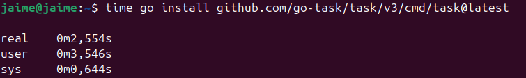

# Gestor de Dependencias

Teniendo en cuenta estos aspectos, en primer lugar se ha decidido buscar el estándar de Go para gestionar las dependencias. Indagando en la documentación oficial de Go, el estándar utilizado para gestionar las dependencias es Go Modules, que viene integrado junto a la instalación de Go (https://go.dev/doc/modules/managing-dependencies). Se ha buscado a su vez información sobre otros gestores de dependencias que no sean el estándar, sin embargo todos están obsoletos y recomiendan utilizar Go Modules. Teniendo en cuenta esto, se ha tomado la decisión de utilizar el gestor de dependencias integrado para que todo fluya de la mejor manera.

# Gestor de Tareas

La decisión sobre el gestor de tareas depende de los siguientes criterios:

- Tiempo de instalación.
- Tiempo de ejecución.

- make: permite automatizar comandos repetitivos. Su instalación en muchos entornos no es necesaria (viene instalado por defecto). Es la más simple de configurar aunque su sintaxis en ocasiones puede resultar algo liosa. Buscando acerca de este gestor de tareas, encontré un post en Reddit dónde cataloga este gestor como uno de los mejores para este tipo de tareas (https://www.reddit.com/r/golang/comments/5f0st7/preferred_task_manager_for_go_projects/). Se ha hecho una medición del tiempo de instalación en un docker con la imagen de Ubuntu, que no viene por defecto instalado, dando el siguiente resultado:

Otro criterio importante a la hora de decantarse por un gestor de tareas u otro es el tiempo de ejecución de las tareas. En el caso de make, la orden check tarda lo siguiente:

- Task: es una herramienta que la propia documentación de Go trata como un gestor de tareas con el objetivo de ser más simple y sencillo de usar que make (https://pkg.go.dev/github.com/go-task/task). El mayor inconveniente con respecto a make es el proceso de instalación, que es algo más complejo:

El binario ocupa 74 MB (mucho más que make) y hay que utilizar estos comandos para añadir /go/bin al PATH:
echo 'export PATH=$PATH:$HOME/go/bin' >> ~/.bashrc
source ~/.bashrc
En cuanto al tiempo de ejecución, Task tarda lo siguiente:

- Just: gestor de tareas estándar de Rust. Al igual que Task, tiene una sintaxis más clara que make, sin embargo, es un binario externo escrito con Rust, por lo que los entornos o colaboradores del proyecto lo tienen que instalar por separado.

El tiempo de instalación también es algo más elevado que make y Task.
En cuanto al tiempo de ejecución, Just tarda lo siguiente:

- tj/robo: este gestor de tareas tiene una sintaxis nativa en YAML y está diseñado exclusivamente a tareas. El problema principal es que su mantenimiento es escaso a día de hoy. La instalación tampoco viene integrada como make.

En cuanto al tiempo de ejecución, tj/robo tarda lo siguiente:

Aunque todas las opciones son aceptables, siendo todas estables y mantenidas, el hecho de tener que depender de binarios externos tanto para Task como para Just, hace que me decante por utilizar make, pese a tener una sintaxis algo más quisquillosa. Además, teniendo en cuenta el importante criterio sobre el tiempo de ejecución, task tarda bastante más que make y just, cuyos ambos gestores de tareas tienen tiempos similares, ligeramente inferiores en make, por lo que otra razón para decidirse por este simple y efectivo gestor. Se descarta tj/robo pues es un proyecto algo antiguo.

# Herramientas para Tests

Para elegir las herramientas para tests, se siguen los siguientes criterios:

- Dependencias. Si la biblioteca supone añadir demasiadas dependencias, esto impacta en el rendimiento del proyecto y puede ser un problema

- Ejecución en línea de comandos.

Go incorpora de forma nativa un Test Runner llamado testing y el comando "go test" para ejecutar los ficheros con "_test.go" que incorporan los tests sobre un paquete en específico. Testing no tiene aserciones como tal, por lo que las comparaciones se hacen de forma manual, es decir, la aserción sería un if que compara y llama a "t.Errorf" si no se cumple. La ventaja es poder prescindir de dependencias externas y que "testing" no escribe ningún lockfile ni fichero en el directorio de fuentes (sí en otros sitios, que se pueden gestionar y controlar)

- testify. Una de las bibliotecas de testing más usadas en Go. Es necesario instalarla con "go get" y se compone de varios paquetes, entre los que incluye "assert", aserciones que, al fallar, marcan el test como fallido pero continúan. El problema es que arrastra dependencias como go-spew, go-difflib y yaml.v3. No escribe tampoco en el directorio de fuentes. Es menos explícita que simplemente usar testing de forma manual.

- Ginkgo y Gomega. Gomega es una Biblioteca de "matchers" que viene emparejada con Ginkgo (Test Runner) dónde las aserciones se pueden leer como frases (Expect(x).To(Matcher)). Es mucho más complejo de entender que testify o testing y nuevamente arrastra varias dependencias. No escribe en el directorio de fuentes. Ginkgo, por su parte, es un Test Runner que habría que instalar adicionalmente y trae también varias dependencias consigo. Es muy buena para BDD

Se decide finalmente optar por no incluir una biblioteca de aserciones y utilizar testing para las comprobaciones, de manera explícita y controlada, para evitar así añadir dependencias e instalaciones que otros colaboradores tendrán que seguir para implementar los tests. Ginkgo puede ser demasiado para este proyecto. Como nota adicional "go test" no escribe en el directorio de fuentes, tan solo en una caché fuera del repositorio (GOCACHE)

