# Gestor de Dependencias

Teniendo en cuenta estos aspectos, en primer lugar se ha decidido buscar el estándar de Go para gestionar las dependencias. Indagando en la documentación oficial de Go, el estándar utilizado para gestionar las dependencias es Go Modules, que viene integrado junto a la instalación de Go (https://go.dev/doc/modules/managing-dependencies). Se ha buscado a su vez información sobre otros gestores de dependencias que no sean el estándar, sin embargo todos están obsoletos y recomiendan utilizar Go Modules. Teniendo en cuenta esto, se ha tomado la decisión de utilizar el gestor de dependencias integrado para que todo fluya de la mejor manera.

# Gestor de Tareas

La decisión sobre el gestor de tareas depende de los siguientes criterios:

- Tiempo de instalación.
- Tiempo de ejecución.

- make: permite automatizar comandos repetitivos. Su instalación en muchos entornos no es necesaria (viene instalado por defecto). Es la más simple de configurar aunque su sintaxis en ocasiones puede resultar algo liosa. Buscando acerca de este gestor de tareas, encontré un post en Reddit dónde cataloga este gestor como uno de los mejores para este tipo de tareas (https://www.reddit.com/r/golang/comments/5f0st7/preferred_task_manager_for_go_projects/). Se ha hecho una medición del tiempo de instalación en un docker con la imagen de Ubuntu, que no viene por defecto instalado, dando el siguiente resultado:
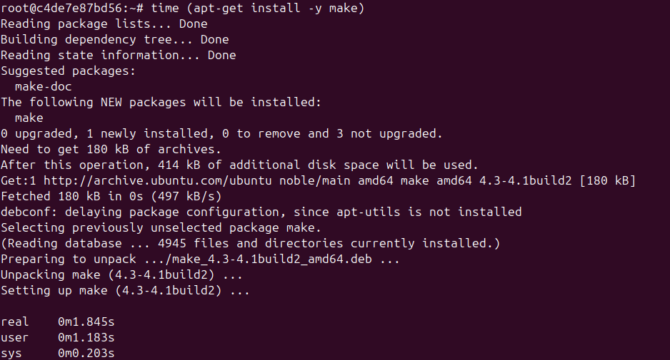
Otro criterio importante a la hora de decantarse por un gestor de tareas u otro es el tiempo de ejecución de las tareas. En el caso de make, la orden check tarda lo siguiente:
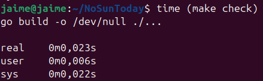

- Task: es una herramienta que la propia documentación de Go trata como un gestor de tareas con el objetivo de ser más simple y sencillo de usar que make (https://pkg.go.dev/github.com/go-task/task). El mayor inconveniente con respecto a make es el proceso de instalación, que es algo más complejo:

El binario ocupa 74 MB (mucho más que make) y hay que utilizar estos comandos para añadir /go/bin al PATH:
echo 'export PATH=$PATH:$HOME/go/bin' >> ~/.bashrc
source ~/.bashrc
En cuanto al tiempo de ejecución, Task tarda lo siguiente:
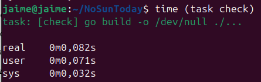

- Just: gestor de tareas estándar de Rust. Al igual que Task, tiene una sintaxis más clara que make, sin embargo, es un binario externo escrito con Rust, por lo que los entornos o colaboradores del proyecto lo tienen que instalar por separado.
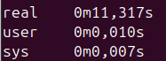
El tiempo de instalación también es algo más elevado que make y Task.
En cuanto al tiempo de ejecución, Just tarda lo siguiente:
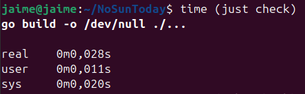

- tj/robo: este gestor de tareas tiene una sintaxis nativa en YAML y está diseñado exclusivamente a tareas. El problema principal es que su mantenimiento es escaso a día de hoy. La instalación tampoco viene integrada como make.
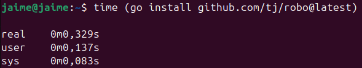
En cuanto al tiempo de ejecución, tj/robo tarda lo siguiente:
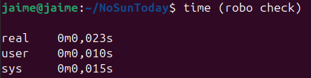

Aunque todas las opciones son aceptables, siendo todas estables y mantenidas, el hecho de tener que depender de binarios externos tanto para Task como para Just, hace que me decante por utilizar make, pese a tener una sintaxis algo más quisquillosa. Además, teniendo en cuenta el importante criterio sobre el tiempo de ejecución, task tarda bastante más que make y just, cuyos ambos gestores de tareas tienen tiempos similares, ligeramente inferiores en make, por lo que otra razón para decidirse por este simple y efectivo gestor. Se descarta tj/robo pues es un proyecto algo antiguo.

# Herramientas para Tests

## Biblioteca de Aserciones

Para elegir la biblioteca de aserciones, se siguen los siguientes criterios:

- Tiempo de Ejecución.

Opciones:

- "Simular" aserciones. Testing, el framework nativo que usa Go para escribir los tests, no dispone como tal de una biblioteca de aserciones, aunque es posible hacer las comparacions de forma manual, es decir, la aserción sería un if que compara y llama a "t.Errorf" si no se cumple. Para calcular el tiempo de ejecución, se realiza con la herramienta "Hyperfine" que permite medir la orden completa desde el sistema operativo. Además todas las mediciones se hacen con el comando "go test -count=1 ./..." para forzar que en cada iteración se ejecuten realmente los tests. Además "Hyperfine" permite hacer pruebas de calentamiento para estabilizar cachés de disco del SO. Se realizan 20 iteraciones sobre el test "ruta_optima_test.go" que solo utiliza testing.
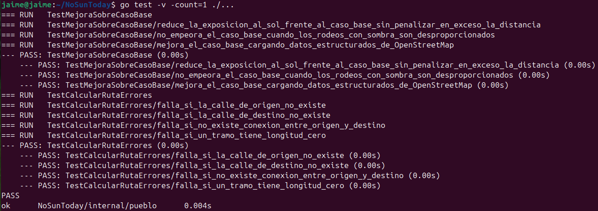
Usando testing para comprobar manualmente podemos observar que el tiempo real de ejecución tras 20 mediciones es de 147.8 ms de media.

- testify. Funciona tanto como para escribir los tests como para usarse como biblioteca de aserciones. Se instala con "go get" y esta compuesta de varios paquetes, siendo "assert" el paquete que incluye las aserciones. Para medir el tiempo de ejecución, se vuelve a utilizar el comando anterior pero realizando modificaciones en el test medido para que haga uso de la biblioteca de aserciones de testify.
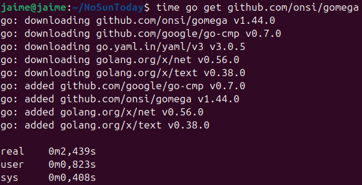
Aquí se puede ver un extracto del test reescrito usando testify. Ahora, en cuanto al tiempo de ejecución:
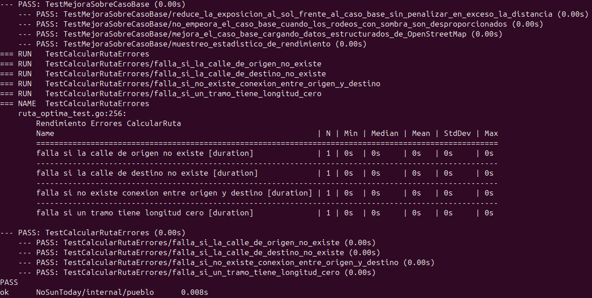
Usando testify como biblioteca de aserciones podemos observar que el tiempo real de ejecución tras 20 mediciones es de 240.3 ms de media.

- Gomega. Gomega es una Biblioteca de "matchers" que viene emparejada con Ginkgo (Test Runner) dónde las aserciones se pueden leer como frases (Expect(x).To(Matcher)). Nuevamente se utiliza "Hyperfine" para las mediciones de tiempo, no sin antes reescribir el código haciendo uso de esta biblioteca de aserciones:
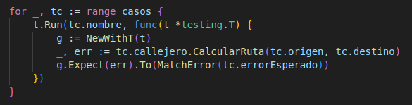
Aquí se puede ver un extracto del test reescrito usando Gomega. Ahora, en cuanto al tiempo de ejecución:
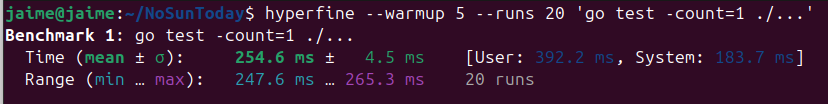
Usando Gomega como biblioteca de aserciones podemos observar que el tiempo real de ejecución tras 20 mediciones es de 254.6 ms de media.

La decisión final es utilizar testing directamente para escribir las comparaciones. El criterio avala mi decisión, pues tiene el menor tiempo de ejecución de media entre las tres opciones.

## Herramientas CLI

Para elegir la herramienta para ejecutar los tests, se siguen los siguientes criterios:

- Tiempo de Ejecución.

Opciones:

- "Go test". El estándar de Go, viene al instalar el lenguaje. Es compatible con los frameworks que se han barajado como candidatos.

- "Ginkgo -v". El CLI de Ginkgo. Es legible y la información se entiende adecuadamente.

- "gotestsum --format testname ./...". Es parecido a "go test" pero más legible.

Para comprobar y medir el criterio definido, se utiliza "Hyperfine" para calcular el tiempo de ejecución de media tras 20 iteraciones, todas sobre el mismo test "ruta_optima_test.go". Como Ginkgo necesita ciertas modificaciones para ejecutar la herramienta, primero se analizan "go test" y "gotestsum":
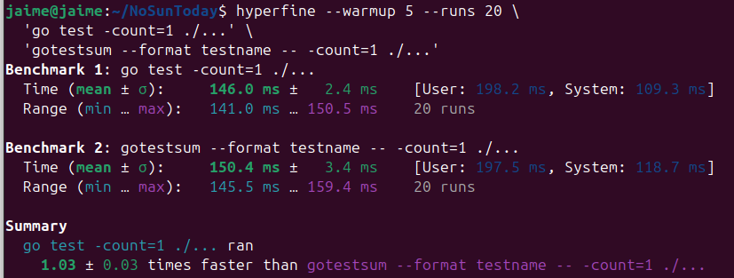
El tiempo de ejecución de media usando "go test" es de 146.0 ms (como pasaba al medir testing en la biblioteca de aserciones), mientras que con "gotestsum" el tiempo de ejecución es de 150.4 ms. La captura incluso dice que "Go test" es un 1.03 veces más rápida que "gotestsum", pero todavía falta analizar Ginkgo. Esta herramienta necesita de un archivo "puente" para ejecutar el test con el que se han medido las dos anteriores herramientas, por lo que se crea el fichero "pueblo_suite_test.go" que Ginkgo requiere para ejecutar el test.
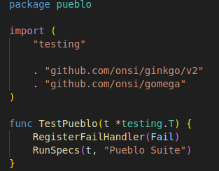
Ahora Gingko podrá ejecutar el mismo test que las otras herramientas, por lo que procedemos a calcular el tiempo de ejecución:
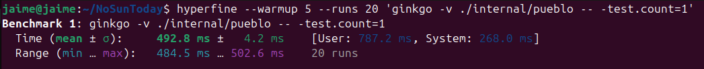
El tiempo de ejecución de media usando Ginkgo es de 492.8 ms

Se decide finalmente utilizar "go test", el cúal además es compatible con todos los frameworks que se van a ver a continuación. Ginko tarda bastante más y "gotestsum" también tiene un tiempo de ejecución ligeramente superior. 

## Framework

Para elegir el Framework, se siguen los siguientes criterios:

- Tiempo de Ejecución.

Opciones:

- Testing. Framework nativo y estándar de Go. Se usa el comando "go test" para ejecutar los ficheros con "_test.go" que incorporan los tests sobre un paquete en específico. Para comprobar el tiempo de ejecución se va a utilizar "Hyperfine" con la herramienta "go test" para todas las opciones, puesto que es la herramienta CLI decidida. Las mediciones se hacen sobre el test "ruta_optima_test.go". El tiempo de ejecución va a ser el mismo que se midió para decidir la biblioteca de aserciones y la herramienta CLI, 146.0 ms - 147.8 ms de media.

- Ginkgo. Es un framework BDD (desarrollo guiado por comportamiento) completo. Tiene su propia herramienta CLI como hemos visto anteriormente, aunque para medir los tiempos de ejecución se va a hacer uso de "go test" para comparar en condiciones semejantes. Se ha reescrito el test para que haga uso de este Framework, además del fichero "pueblo_suite_test.go" que se necesita para ejecutar el código.
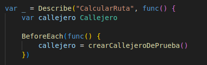
Aquí se observa un extracto del código, utilizando describe. En cuanto al tiempo de ejecución:
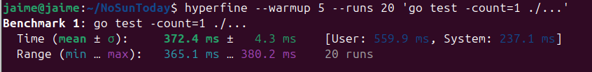
El tiempo de ejecución de media usando Ginkgo es de 372.4 ms

- franela/goblin. Framework minimalista, inspirado en Mocha, que añade sobre Testing. Se reescribe el test usando franela/goblin (no requiere ningún archivo adicional):
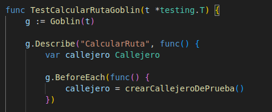
Aquí se observa un extracto del código, que también usa describe. En cuanto al tiempo de ejecución:
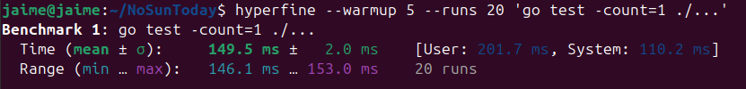
El tiempo de ejecución de media usando franela/goblin es de 149.5 ms

Se decide finalmente utilizar testing como el Framework. El tiempo de ejecución de Ginkgo es bastante superior al de testing y el de franela/goblin, aunque ligeramente, también es superior. Como nota adicional "go test" no escribe en el directorio de fuentes, tan solo en una caché fuera del repositorio (GOCACHE).

